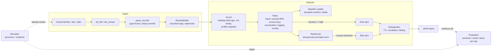

# trailwatch

[](https://github.com/lutherleo/trailwatch/actions/workflows/ci.yml)

Streaming CloudTrail identity-threat detection: per-principal behavioural baselines, stateful
rules, decayed risk scoring and alert deduplication, evaluated against a seeded simulator that
generates months of multi-principal activity with labeled attack sequences injected.

> All evaluation data is **synthetic** (generated by the bundled
> simulator) and the IP-to-network map is **synthetic** (reserved address space, private ASNs).
> Nothing here has been run against a production AWS account. See [Limitations](#limitations).

## What and why

CloudTrail records every AWS management API call, and most cloud intrusions show up there first:
a leaked access key used from a VPS, a phished console password without MFA followed by a
backdoor user, a burst of `List*`/`Describe*` calls, `StopLogging`. Writing a rule for each of
those is easy. Keeping the false-positive rate bearable is not, because normal accounts are full
of look-alikes: employees travel, split-tunnel VPNs egress on another continent, mobile carriers
geolocate a user 1,500 km away, posture scanners enumerate every service every few hours,
Terraform touches 25 APIs per run, SSO console sign-ins always report `MFAUsed: No`, and admins
create access keys for new hires.

trailwatch is a small, readable detection engine that tackles that problem the way production
UEBA-style detectors do (baseline per principal, suppress what is familiar, accumulate weak
signals into a decaying risk score, deduplicate) and, just as important, ships an
**evaluation harness** that measures precision, recall and alerts/day on held-out simulated
accounts, with ablations showing what each mechanism buys.

**Who it is for:** detection engineers and cloud-security practitioners who want a worked,
end-to-end example of behavioural detection over CloudTrail, including how to evaluate it
honestly and how a streaming detector bounds its memory.

## Features

- **Streaming ingest** of CloudTrail log files (`{"Records": [...]}`, gzipped or not), JSON
  lines, whole directories (ordered by the delivery timestamp in CloudTrail file names) or stdin;
  malformed records and duplicate `eventID`s are counted and skipped; unreadable files (corrupt
  or truncated gzip, non-UTF-8 bytes, I/O errors) are logged, counted as `bad_files` and skipped
  without stopping the run; a bounded **reorder buffer** (watermark = max event time - 15 min)
  restores time order.
- **Per-principal baselines** with exponential decay (30-day half-life): APIs, regions, user-agent
  *families*, ASNs, countries and derived habits, plus account-wide API popularity.
  Principals are keyed sensibly (IAM user ARN, role ARN, per-person SSO session, root).
- **Six rule families (rules as code, unit tested):** impossible travel, console sign-in without
  MFA then IAM changes, unusual access-key creation, enumeration bursts, audit/detection
  tampering (CloudTrail, GuardDuty, Config, flow logs), behavioural novelty.
- **Risk scoring with decay** (6 h half-life) that turns several weak findings into one alert.
- **Alert dedup** (per rule/principal/key, TTL on last-seen, escalation on higher severity;
  risk alerts fold into an open rule alert for the same principal).
- **Bounded state everywhere:** LRU tables, capped sliding windows, top-K decayed counters.
- **Simulator:** 19 principals (humans with schedules, travel, VPNs, MFA habits; CI, scanner,
  pipeline and app roles; AWS service events), 6 labeled incident scenarios, CloudTrail-shaped
  records, realistic out-of-order delivery, output as JSONL or an `AWSLogs/` tree.
- **Evaluation:** held-out seeds, precision / recall / alerts per day / time to detect,
  per-scenario recall, ablations, and a tuner that only ever sees the tuning seeds.
- **CLI + JSON alerts**, baseline snapshots (`--state-in/--state-out`), `--fail-on` exit code.
- Zero runtime dependencies (stdlib only, Python 3.12).

## Architecture



Rules see each event *before* the baseline learns it, so "new" really means new. Deeper design,
algorithms and complexity: [docs/ARCHITECTURE.md](docs/ARCHITECTURE.md). Threat model:
[docs/THREAT_MODEL.md](docs/THREAT_MODEL.md). Every judgement call: [DECISIONS.md](DECISIONS.md).

## Quickstart

```bash
uv sync                     # Python 3.12, dev tools only; no runtime dependencies
make check                  # format + lint + strict mypy + 189 tests with coverage gate
make demo                   # offline end-to-end demo (simulate -> detect -> score)

# Simulate an account and detect on it yourself
uv run trailwatch simulate --out data --seed 7 --days 45 --format cloudtrail
uv run trailwatch detect data/AWSLogs --out alerts.jsonl --stats
uv run trailwatch score --alerts alerts.jsonl --dataset data

# Real CloudTrail logs (bring your own IP map in the same CSV schema for useful geo rules)
uv run trailwatch detect ~/trail-export/ --netmap my-netmap.csv --fail-on critical
zcat *.json.gz | uv run trailwatch detect -          # stdin: records or {"Records": [...]} per line

uv run trailwatch rules     # rule catalogue with ATT&CK techniques
uv run trailwatch config    # effective configuration as TOML (see config/default.toml)
```

## Demo output

Pasted from a real `make demo` run (seed 7, 45 days). Lines are verbatim; the incident list and
alert table are trimmed (`...`), keeping the first 12 alerts and every false positive:

```text
== 1. Simulate 45 days of a 19-principal account (seed 7) as a gzipped CloudTrail tree
wrote 45165 events (167 labeled, 12 incidents, 19 principals) in 8976 file(s) to demo-out/data
  inc-7-01  day  19  stolen_access_key        victim=dev-02           events=17
  inc-7-03  day  42  console_no_mfa_privesc   victim=legacy-01        events=7
  inc-7-07  day  35  recon_burst              victim=dev-04           events=44
  inc-7-09  day  28  defense_evasion          victim=admin-01         events=5
  inc-7-11  day  42  low_and_slow             victim=orders-app       events=5
  ...

== 3. Alerts (TP = cites an injected incident event; FP = benign activity)
2026-01-13T20:22:49Z  medium   risk_threshold               user/admin-01                Elevated risk for user/admin-01                            FP
2026-01-15T10:20:34Z  medium   risk_threshold               user/admin-02                Elevated risk for user/admin-02                            FP
2026-01-16T16:23:32Z  critical console_no_mfa_iam_change    user/legacy-01               IAM change (UpdateLoginProfile) after console sign-in with FP
2026-01-24T20:17:53Z  high     behavioral_novelty           user/dev-02                  First call from country VN                                 TP inc-7-01
2026-01-27T13:47:08Z  high     behavioral_novelty           user/admin-02                First call from country NL                                 TP inc-7-10
2026-01-27T13:48:39Z  high     logging_disabled             user/admin-02                Audit/detection tampering: PutEventSelectors               TP inc-7-10
2026-01-27T13:50:30Z  critical logging_disabled             user/admin-02                Audit/detection tampering: DeleteDetector                  TP inc-7-10
2026-01-27T13:51:51Z  high     logging_disabled             user/admin-02                Audit/detection tampering: StopConfigurationRecorder       TP inc-7-10
2026-01-28T19:50:10Z  high     impossible_travel            user/legacy-01               Impossible travel: Austin, US -> Lagos, NG                 TP inc-7-04
2026-01-28T19:50:10Z  high     behavioral_novelty           user/legacy-01               First call from country NG                                 TP inc-7-04
2026-01-28T19:54:19Z  critical console_no_mfa_iam_change    user/legacy-01               IAM change (CreateUser) after console sign-in without MFA  TP inc-7-04
2026-01-28T19:59:00Z  high     unusual_access_key_creation  user/legacy-01               Access key created for svc-backup-41                       TP inc-7-04
...
2026-02-15T20:00:00Z  critical logging_disabled             role/terraform-ci            Audit/detection tampering: DeleteTrail                     FP

== 4. Score against ground truth
{
  "alerts": 30,
  "true_alerts": 26,
  "precision": 0.8667,
  "incidents": 12,
  "detected": 10,
  "recall": 0.8333,
  "alerts_per_day": 0.6667,
  "missed": [
    "inc-7-11 (low_and_slow)",
    "inc-7-12 (low_and_slow)"
  ]
}
```

The three kinds of false positive in that run are the realistic ones the simulator plants: an
admin's first-ever onboarding burst (new IAM APIs adding up to a risk alert), a legacy user
without MFA making a genuine IAM change, and Terraform tearing down a sandbox trail.

## Alert format

One JSON object per line (`trailwatch detect --out alerts.jsonl`):

| field | meaning |
|---|---|
| `alert_id` | stable id (`tw-` + 16 hex of SHA-256 over kind/rule/principal/time/key) |
| `kind` | `rule` (one severe finding) or `risk` (decayed score crossed `scoring.threshold`) |
| `rule_id`, `severity`, `title`, `summary` | what fired and why, `info`..`critical` |
| `principal`, `account_id` | baseline key of the identity and its account |
| `created`, `last_seen`, `count` | emission time; folded duplicates update these in memory (streamed JSON reflects the moment of emission) |
| `risk_score` | principal's decayed risk score at emission |
| `techniques` | MITRE ATT&CK technique ids |
| `findings[]` | contributing findings with their own `evidence` event ids and `attrs` |
| `evidence[]` | `event_id`, `time`, `api`, `source_ip`, `region` of supporting events |

## Rules

| rule | fires on | key suppression / escalation | ATT&CK |
|---|---|---|---|
| `impossible_travel` | consecutive geolocated calls implying > 1,000 km/h over > 500 km | suppressed if both ASNs familiar; -1 for VPN/mobile networks; -1 before warm-up | T1078.004 |
| `console_no_mfa_iam_change` | IAM write within 120 min of an IAM-user/root console sign-in with `MFAUsed: No` (critical); the sign-in itself (low) | federated sign-ins ignored (MFA is at the IdP); routine no-MFA sign-in silent; -1 if the IAM API is familiar | T1078.004, T1098 |
| `unusual_access_key_creation` | `CreateAccessKey`: root (critical), for another principal (high), for self (medium) | -2 if routine habit; -1 onboarding (caller created that user within the hour); +1 no-MFA interactive; +1 new network; -1 failed | T1098.001 |
| `enumeration_burst` | >= 20 distinct discovery APIs across >= 4 services, or >= 12 access denials, within 10 min | volume-only bursts suppressed up to 1.25x the principal's historical daily peak; once per window unless severity rises | T1580, T1526, T1087.004 |
| `logging_disabled` | `StopLogging`, `DeleteTrail`, trail/event-selector weakening, GuardDuty delete/disable, Config recorder stop, flow-log deletion | optional trail-name allowlist; -1 for failed attempts | T1562.008, T1562.001 |
| `behavioral_novelty` | first region / UA family / ASN / country / rare-or-sensitive API for a warmed-up principal; pentest distro UA (always high) | +1 hosting networks; +1 regions new to the whole account | T1078.004 |

## Evaluation

**Protocol.** The simulator is seeded. Seeds **1-3** were used during development and for the
parameter search; seeds **1001-1005** were run once, after the code and configuration were
frozen, and are the only numbers reported below. Each seed is a 90-day, 19-principal account
with 12 injected incidents (2 per scenario) after day 21, delivered out of order (up to 5 min)
and fed through the full ingest path. An alert is a true positive if it cites any event of an
injected incident; an incident is detected if any alert cites one of its events.

```bash
make eval    # = uv run trailwatch eval --seeds 1001-1005 --days 90 --ablations --json eval/heldout.json
```

Held-out results ([eval/heldout.md](eval/heldout.md), [eval/heldout.json](eval/heldout.json)):

| variant | incidents | detected | recall | alerts | precision | alerts/day | false alerts/day | median TTD (min) |
|---|---:|---:|---:|---:|---:|---:|---:|---:|
| full | 60 | 50 | 0.833 | 158 | 0.867 | 0.351 | 0.047 | 0.0 |
| no_familiarity_suppression | 60 | 50 | 0.833 | 2531 | 0.060 | 5.624 | 5.289 | 0.0 |
| no_behavioral_novelty | 60 | 45 | 0.750 | 107 | 0.878 | 0.238 | 0.029 | 0.0 |
| no_risk_scoring | 60 | 47 | 0.783 | 141 | 0.929 | 0.313 | 0.022 | 0.0 |

Per-scenario recall (full): `stolen_access_key` 1.0, `console_no_mfa_privesc` 1.0,
`access_key_persistence` 1.0, `recon_burst` 1.0, `defense_evasion` 1.0, `low_and_slow` **0.0**.
False alerts by rule (full, 450 account-days): `risk_threshold` 11, `console_no_mfa_iam_change` 8,
`logging_disabled` 2.

What the ablations say:

- **Familiarity suppression is what makes the detector usable**: without it the same recall
  costs 5.3 false alerts/day instead of 0.047 (VPN egress and mobile carriers trip impossible
  travel; scanners and Terraform trip enumeration).
- **Behavioural novelty** and **risk scoring** each add recall (5 and 3 of 60 incidents) at the
  price of extra false alerts; the risk score is where most remaining false positives come from.
- **`low_and_slow` is missed by design**: an insider-style actor using the workload's own network,
  tooling and mostly-familiar APIs is invisible to these baselines. It is in the scenario set to
  keep the headline recall honest.
- Median time to detect is 0 minutes because most scenarios trip a rule on their first or
  second event (the first call from a new country already differs from the baseline); TTD is
  measured in event time and ignores real CloudTrail delivery latency (~5-15 min).

**Tuning** (`make tune`, seeds 1-3 only, output in [eval/tune.md](eval/tune.md)): a grid over
`scoring.threshold` x `scoring.half_life_hours`, maximising recall subject to <= 0.05 false
alerts/day. Eight grid points tied (recall 0.833, precision 0.899); the shipped defaults
(threshold 60, half-life 6 h) are one of them (see DECISIONS.md for the tie-break).

## Benchmarks

```bash
make bench   # = uv run python scripts/bench.py
```

On an Apple-silicon laptop (Python 3.12.13, single process, while other builds were running):

```text
throughput: 88416 events (90 simulated days) in 1.80 s = 49,013 events/s, 29 alerts
bounded state (caps = 1000 principals, 60k events):
    1000 distinct principals -> peak traced memory   24.9 MB
   10000 distinct principals -> peak traced memory   24.4 MB
   60000 distinct principals -> peak traced memory   24.4 MB
```

Throughput is parse + detect on pre-generated records. The memory test streams 60k events from
up to 60k distinct principals through a detector capped at 1,000 principals: peak memory stays
flat, which is the point of the bounded design. `make eval` prints a lower "end-to-end" rate
because it includes simulation and delivery reordering.

Quality gate numbers: `make check` -> 189 tests, line+branch coverage 98.7% (threshold 90%);
`make loc` -> 5,191 lines in `src/` (including docstrings), 2,160 in `tests/`.

## Design decisions (summary)

- **Baselines on families, not strings**: user-agent families and ASNs rather than raw UA
  strings and IPs, so SDK upgrades and DHCP churn are not "new".
- **Score before learn**: rules evaluate against the profile as it was before the event.
- **Familiarity, not allowlists**: suppression comes from the principal's own decayed history
  (VPN pairs, scan peaks, routine key creation) rather than hand-maintained lists.
- **Federated sign-ins are not "no MFA"**: CloudTrail cannot see IdP MFA, so the console rule
  only trusts `MFAUsed` for IAM users and root.
- **Bounded by construction**: every table has a configured cap; overflow evicts (LRU or lowest
  decayed weight) instead of growing.
- **Honest evaluation**: tuning and reporting seeds are disjoint; ablations are reported; a
  scenario the design cannot catch is included.

Full list with costs-if-wrong: [DECISIONS.md](DECISIONS.md).

## Limitations

- **Synthetic everything.** Both the benign behaviour and the attacks come from a simulator the
  same project builds alongside the detector. The numbers show the mechanisms work on the
  behaviours that were modelled; they are not an estimate of performance on a real account,
  where behaviour is far more diverse and the false-positive rate will be higher.
- **Synthetic IP intelligence.** The bundled map covers only reserved ranges. On real logs every
  public IP is "unknown" until you supply a real IP-to-ASN/geo CSV, which disables impossible
  travel and network novelty.
- **Management events only.** Data events (S3 object access, Lambda invokes), Organizations
  multi-account trails, CloudTrail Lake and EventBridge delivery are out of scope.
- **Single process, in-memory.** No sharding or durable state beyond JSON baseline snapshots;
  rule windows (travel, login windows, bursts) are not persisted across runs.
- **Streamed alerts are written at emission.** Later duplicates fold into the in-memory alert
  (and are counted in `--stats`), but are not re-emitted to the JSONL stream.
- **Baseline poisoning.** An attacker active long enough becomes "familiar"; there is no
  separate trusted-baseline period after warm-up.
- **Small population.** 19 principals per account; behaviour at thousands of principals (peer
  groups, long-tail APIs) is not exercised by the evaluation, only by the memory benchmark.
- **Median TTD** ignores CloudTrail delivery latency and the reorder buffer's 15-minute hold.

## Roadmap

- Peer-group baselines (compare a principal with similar principals) for new principals.
- Emit alert updates (escalations, folded counts) as a second JSONL record type.
- Persist rule windows in snapshots; S3/SQS notification consumer for live trails.
- Data-event support (S3 GetObject volume anomalies) and Organizations trails.
- Calibrated risk weights learned from labeled data instead of fixed severity weights.

## Project layout

```text
src/trailwatch/        model, parse, ingest, netmap, useragent, window, baseline, scoring,
                       alerts, engine, config, evaluation, cli
src/trailwatch/rules/  one module per rule family (rules as code)
src/trailwatch/sim/    catalog, records, personas, incidents, generator
tests/                 rule tests, property tests, pipeline, golden fixture, CLI/eval tests
fixtures/              hand-authored CloudTrail log file + golden alerts
config/default.toml    generated dump of the built-in defaults (test-enforced)
eval/                  held-out evaluation and tuning outputs
scripts/               demo, benchmark, alert viewer
docs/                  ARCHITECTURE.md, THREAT_MODEL.md
```

## License

MIT, see [LICENSE](LICENSE).

## Maintainer

Originally developed under the `lutherleo` GitHub account; currently maintained by **Love Kush Pranu**, Software Developer.

- GitHub: [lutherleo](https://github.com/lutherleo)
- LinkedIn: [lovekush-pranu](https://linkedin.com/in/lovekush-pranu)
- Email: [lp2989@nyu.edu](mailto:lp2989@nyu.edu)