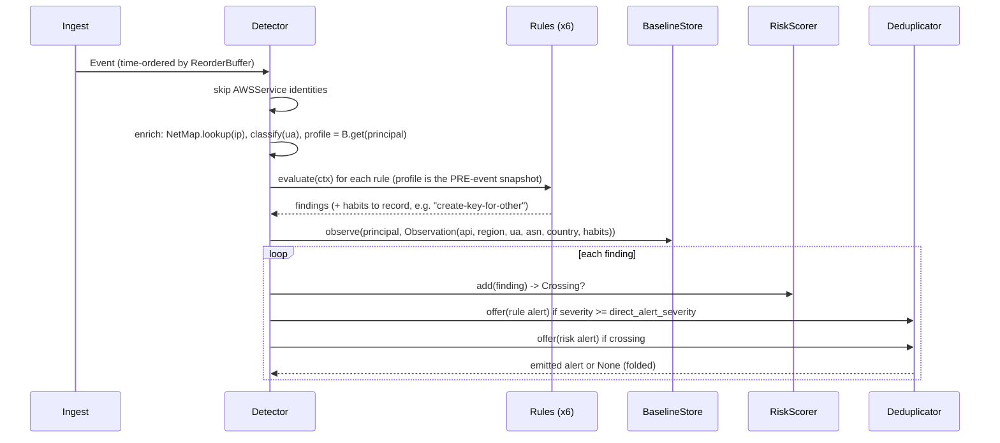

# Architecture

This document describes how trailwatch is put together, the algorithms inside each stage, and
their time and space complexity. Notation: *N* = events processed, *P* = distinct principals,
*R* = number of rules, *M* = rows in the network map, *K* = a per-structure cap from the config.

## Module map

| module | responsibility |
|---|---|
| `model.py` | immutable `Event`, `Identity`, `Finding`; mutable `Alert` (for dedup folding); `Severity` |
| `parse.py` | raw CloudTrail dict -> `Event`; principal-key derivation; console sign-in helpers |
| `ingest.py` | file/dir/stdin readers (per-file guard: unreadable files counted as `bad_files` and skipped), `parse_records` (malformed + duplicate handling), `ReorderBuffer` |
| `netmap.py` | IP -> `NetInfo` (ASN, org, kind, country, city, lat/lon), haversine distance |
| `useragent.py` | raw user agent -> stable family |
| `window.py` | `BoundedLRU`, `TimeWindow`, `DecayedCounter` |
| `baseline.py` | `PrincipalProfile`, `GlobalStats`, `BaselineStore` (+ JSON snapshots) |
| `rules/*.py` | one module per rule family; `rules/base.py` defines `Rule` and `EventContext` |
| `scoring.py` | `RiskScorer`: decayed per-principal score and threshold crossings |
| `alerts.py` | alert construction, `Deduplicator`, JSON serialisation |
| `engine.py` | `Detector`: the per-event pipeline and run statistics |
| `config.py` | typed, validated TOML configuration with dotted overrides |
| `sim/*` | simulator: API/UA/network catalogues, record builders, personas, incidents, generator |
| `evaluation.py` | seed runs, matching alerts to incidents, summaries, tuning, ablations, file scoring |
| `cli.py` | `detect`, `simulate`, `eval`, `tune`, `score`, `rules`, `config` |

## Per-event pipeline

Rules run before the baseline update so a value seen for the first time is new for every rule
that looks at it. Rules may also append "habits" to the context (derived behaviours such as
"created a key for another user" or "signed in without MFA") which the baseline then learns, so
routine behaviour is learned from the same mechanism as APIs and networks.

## Ingest

* **Readers.** `iter_file` loads one CloudTrail log file (a single JSON document; real files are
  at most a few MB) or streams a JSON-lines file line by line; `iter_stream` reads stdin line by
  line, where each line is either a record or a whole `{"Records": [...]}` object. Directories are
  expanded recursively and ordered by `delivery_sort_key`, which extracts the
  `YYYYMMDDTHHMMZ` stamp from CloudTrail file names: a plain path sort would replay all of
  `us-east-1` before any of `us-west-2`, which breaks every stateful rule.
* **Parsing** is strict about `eventID`, `eventTime`, `eventName`, `eventSource` and
  `userIdentity`, lenient elsewhere. Bad records are logged and counted, never fatal.
  Duplicate `eventID`s (CloudTrail occasionally delivers twice) are dropped using a bounded LRU
  of recently seen ids (200k).
* **Reorder buffer.** A min-heap keyed by event time. Each push advances the watermark
  `max_event_time - max_lateness` (default 900 s) and releases everything at or below it. If the
  heap exceeds `max_items` the oldest event is released early (`forced`). Events older than the
  last released event are still processed (security events are never dropped) and counted as
  `late`; rules guard against negative time deltas.
  *Cost:* O(log B) per event for buffer size B <= `max_items`; memory O(`max_items`).

## Enrichment

* **Network map.** Ranges are converted to integer `[start, end]` pairs per IP version, sorted,
  and checked for overlap at load. Lookup is `bisect_right` over the starts: O(log M), fronted
  by a 65,536-entry LRU cache (O(1) amortised on repeats). Service hostnames such as
  `ec2.amazonaws.com` (CloudTrail's `sourceIPAddress` for service-made calls) do not parse as IPs
  and return `None`.
* **User-agent families.** An ordered first-match table over the lower-cased string, cached with
  `functools.lru_cache(4096)`. Families are deliberately coarse (`aws-cli`, `boto3`, `terraform`,
  `console`, `browser`, `scripted-http`, `offensive-distro`, ...).
* **Principal keys** (`parse.parse_identity`): IAM users by ARN; role sessions by role ARN
  (sessions of a machine role share one baseline); IAM Identity Center (SSO) sessions by role ARN
  + session name, because the session name is the person; root by `arn:aws:iam::<acct>:root`;
  AWS services by `service:<invokedBy>` (skipped by the engine).

## Bounded state primitives (`window.py`)

| structure | operations | cost | bound |
|---|---|---|---|
| `BoundedLRU` | get / put / get_or_create | O(1) (`OrderedDict.move_to_end`) | `capacity` keys |
| `TimeWindow` | add / expire / distinct / count | amortised O(1): deque of `(t, item)` + `Counter` of items | `max_items` entries and `span` seconds |
| `DecayedCounter` | add / weight / total | O(1) lazy decay; overflow prunes to 90% of capacity by weight, O(K log K) amortised over >= K/10 inserts | `capacity` keys |

Lazy exponential decay: each key stores `(w, t)`. Reading at time `now` returns
`w * 2^(-(now - t) / half_life)`; adding `a` stores `w * 2^(-(now - t)/h) + a` at `now`. The
total is maintained the same way, so `share = weight / total` is O(1). Property tests check the
counter against a brute-force sum over all historical adds, and the window against a brute-force
recomputation of the last `span` seconds.

## Baselines (`baseline.py`)

A `PrincipalProfile` holds one `DecayedCounter` per dimension (API, region, UA family, ASN,
country, habit; 30-day half-life, caps 512/32/16/64/32/64), first/last seen, an event count and
the enumeration "historical daily peak". Semantics:

* **new**: the key is absent (never seen, decayed and pruned, or squeezed out of the top-K);
* **familiar**: decayed weight >= `familiar_min_weight` (3.0, i.e. roughly three recent uses);
* **warmed up**: >= 50 events and >= 7 days since first seen. Novelty findings require warm-up so
  every principal does not alert on its first day.

`GlobalStats` keeps account-wide decayed API counts (cap 4,096) and regions, used to tell a
globally rare API from one that is merely new to this principal, and a region new to the whole
account from one new to a principal.

`BaselineStore` is an LRU over profiles (`max_principals`, default 50,000). Memory is
O(P_cap x sum of per-dimension caps). Snapshots serialise the store to JSON (`--state-out`) and
restore it (`--state-in`), so a daily batch job can resume without a new warm-up.

## Rules

Each rule is a class with `rule_id`, `description`, `techniques` and `evaluate(ctx) -> list[Finding]`.
All per-principal rule state is in a `BoundedLRU` sized by `state.max_rule_principals`.

### Impossible travel (`rules/travel.py`)

State: last geolocated fix per principal `(t, lat, lon, asn, kind, place, event_id)`.
For a new fix: ignore same-ASN moves and late events (never rewind position). Compute haversine
distance *d* and speed *d / max(dt, 1 s)*. Fire when *d* >= 500 km and speed > 1,000 km/h, unless
both ASNs are familiar to the principal (corporate VPN egress and split tunnels produce exactly
this pattern every day). Severity starts at `high`; -1 if either network is a VPN or mobile
carrier (relayed or coarse geolocation); -1 if the principal is not warmed up. Dedup key: the
unordered ASN pair. O(1) per event.

### Console sign-in without MFA, then IAM change (`rules/console_mfa.py`)

On a successful `ConsoleLogin` by an IAM user or root with `MFAUsed: No`: remember
`(t, event_id, ip)` and record the habit. The sign-in itself is `low` (nothing if it is the
principal's habit). Any subsequent IAM write (not `Get/List/Generate/Simulate*`, not
self-service MFA/password calls) within `window_minutes` from an interactive session (console or
browser UA, or `mfaAuthenticated=false`) is `critical`, or `high` if the principal habitually
signs in without MFA and has used that IAM API before. Federated sign-ins (AssumedRole) always
report `MFAUsed: No` because MFA happens at the identity provider; treating them as no-MFA would
make every SSO admin a critical alert, so they are excluded. O(1).

### Unusual access-key creation (`rules/access_keys.py`)

Classifies `CreateAccessKey` by caller and target: root -> critical; key for another principal
(or any key created by a role, which cannot own keys) -> high; key for oneself -> medium. Then:
-2 if the principal routinely does this kind of creation (habit weight >= 1.5), else -1 if the
caller created the target user within the last hour (onboarding pattern, tracked in a bounded
16-entry deque per principal); +1 if made from an interactive session without MFA; +1 from a
network new to a warmed-up principal; -1 if the call failed. O(1).

### Enumeration burst (`rules/enumeration.py`)

Per principal: three `TimeWindow`s over `window_minutes` (distinct discovery APIs, distinct
services, access-denied events) plus the last 20 event ids for evidence. Triggers: *volume*
(>= 20 distinct APIs across >= 4 services) or *denial storm* (>= 12 denials). Volume-only bursts
are suppressed when they do not exceed `peak_margin` (1.25) x the principal's historical daily
peak; the peak only includes *previous* days so a burst is never compared with itself, and decays
2% per day. Fires once per window per principal unless the severity rises (a denial storm can
escalate to high when volume follows). Amortised O(1) per event; memory O(`max_window_items`) per
tracked principal.

### Audit / detection tampering (`rules/logging_tamper.py`)

A dispatch table `(eventSource, eventName) -> classifier(requestParameters)`: CloudTrail
`StopLogging`/`DeleteTrail` (critical), `UpdateTrail` weakening (single-region, no global
events: high; new bucket: medium), `PutEventSelectors` excluding management or write events
(high), GuardDuty `DeleteDetector` (critical) / disable / detach (high), AWS Config recorder or
delivery-channel stop/delete (high), VPC `DeleteFlowLogs` (medium). Optional allowlist of trail
name prefixes; failed attempts one level lower. Stateless, O(1).

### Behavioural novelty (`rules/novelty.py`)

For warmed-up principals: first region (+1 if new to the account), first UA family (medium),
first country (medium, +1 from hosting) or else first ASN (low, +1 from hosting), first API that
is sensitive (medium) or globally rare (< 0.2% of account calls; low). A penetration-testing
distribution in the UA is high regardless of warm-up. Stateless (reads the profile), O(1).

## Risk scoring (`scoring.py`)

`score(t) = sum_i w(sev_i) * 2^(-(t - t_i)/h)` with weights info 0 / low 10 / medium 25 /
high 50 / critical 80 and *h* = 6 h. Maintained incrementally: decay the stored score to the new
finding's time and add its weight, O(1). A *crossing* is reported when the score rises from below
`threshold` (60) to at or above it. The last <= 32 contributing findings within four half-lives
are kept so the risk alert can explain itself. A property test checks the incremental score
against the brute-force sum. Memory O(P_cap x 32).

## Alerts and deduplication (`alerts.py`)

* **Rule alert**: one finding with severity >= `direct_alert_severity` (high).
* **Risk alert**: one crossing; severity medium, or high if the score is >= 2 x threshold.
* **Dedup key**: rule alerts `(rule, principal, finding.dedup_key)`; risk alerts the principal.
  An open alert absorbs repeats while they arrive within `ttl_hours` (12) of its `last_seen`
  (sliding), incrementing `count` and merging evidence/findings (bounded to 50 each). A
  higher-severity repeat is emitted as a new alert (escalation). A risk alert for a principal
  with an open alert of equal or higher severity is folded into that alert. Both tables are LRU
  bounded (`max_entries`).
* **Evidence**: a bounded LRU index (200k) of recent events turns finding evidence ids into
  `(time, api, ip, region)` references.

## Simulator (`sim/`)

* `catalog.py`: API vocabularies per persona, Terraform and scanner API sets, attacker recon
  set, UA templates with version drift, ASN constants.
* `records.py`: CloudTrail record builders (`eventVersion` 1.08 shape, user identities for IAM
  users, roles, SSO sessions and root, console sign-ins with `MFAUsed`).
* `personas.py`: `Human` (weekday sessions in local time from weighted networks, console share,
  MFA, exploration of new APIs, occasional new regions, adoption of a new tool, business trips
  with a travel day each way), `Admin` (routine onboarding incl. keys for new users),
  `LegacyAdmin` (no MFA, occasional real IAM change), `CiRole` (Terraform runs; optional sandbox
  trail teardown), `ScannerRole` (posture scanner, ~50 APIs x 2 regions every 8 h),
  `PipelineRole` (hourly), `AppRole` (unmapped cloud IPs), `ServiceActivity` (AWSService).
* `incidents.py`: six scenarios (see README) built from management-API sequences.
* `generator.py`: population, incident plan, day-by-day generation with a heap that releases
  records once no later day can precede them (local working days straddle UTC midnight), and
  `delivered()` which applies a bounded random delivery delay. Every persona-day and incident
  has its own string-seeded RNG, so benign traffic is identical with or without incidents (a test
  enforces this) and runs are reproducible across processes.

## Evaluation (`evaluation.py`)

`run_seed` simulates a seed, records labels while streaming, pushes records through the same
ingest path the CLI uses (parse, dedup, reorder buffer), runs the detector, and scores alerts:
TP if any cited event id is labeled; an incident is detected when any alert cites it; time to
detect is the event time at which the citing alert fired or absorbed the citing finding, minus
the incident's first event time. `tune` grid-searches config overrides on tuning seeds and returns
every tied-best point. `score_files` does the same matching from the JSONL alert output alone,
which proves the alert format carries enough to tie alerts back to events.

## Complexity summary

| stage | time per event | memory |
|---|---|---|
| parse + duplicate check | O(size of record) | O(200k ids) |
| reorder buffer | O(log B) | O(`ingest.max_buffer`) |
| enrichment | O(log M) (O(1) cached) | O(M + 65k cache) |
| rules (6) | O(1) each, amortised | O(`state.max_rule_principals` x per-rule state) |
| baseline update | O(1) amortised | O(`baseline.max_principals` x caps) |
| scoring | O(1) | O(principals x 32) |
| dedup | O(1) + O(evidence cap) on merge | O(`dedup.max_entries`) |

End to end: O(N log B) time and O(1) memory in *N* (bounded by configuration), measured at
~49k events/s on one core (see README benchmarks).
